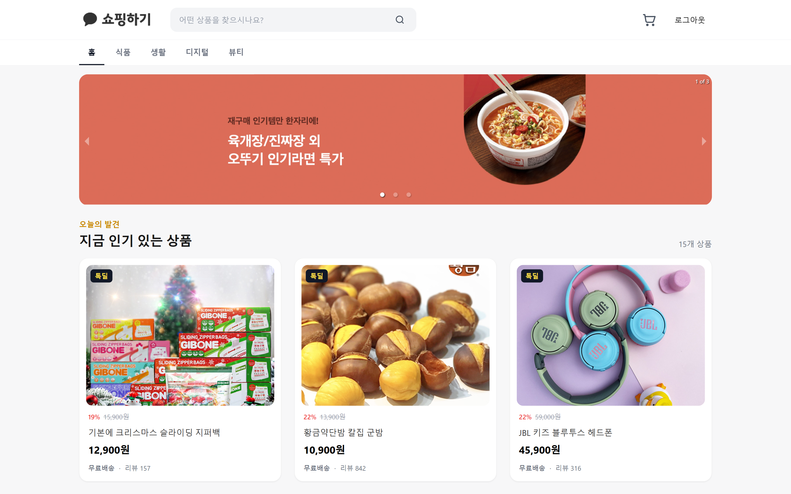
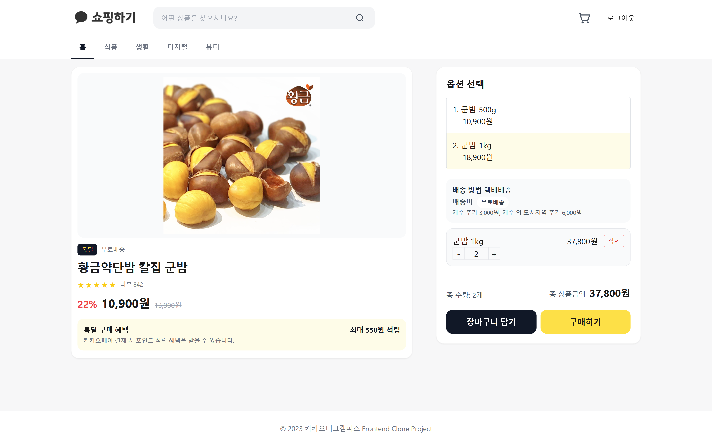
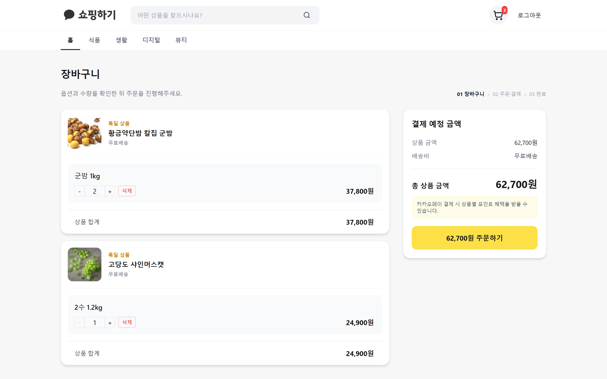
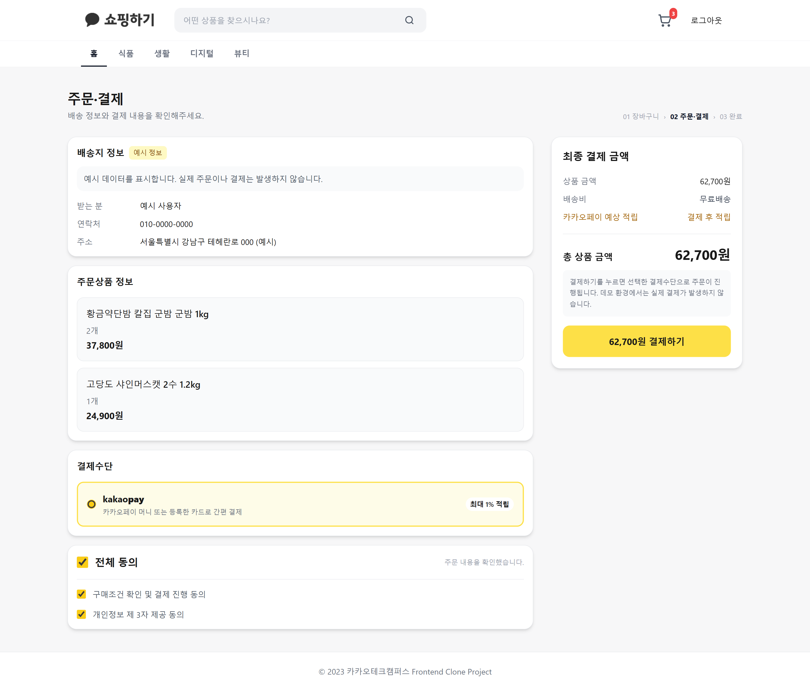
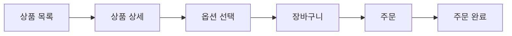

# Kakao Shopping

[](https://github.com/minjuko/kakao-shopping-frontend/actions/workflows/ci.yml)

> **화면·인터페이스 요구사항과 REST API를 기반으로 구현한 React 쇼핑 서비스**

카카오 테크 캠퍼스 프론트엔드 교육 과정에서 진행한 프로젝트입니다. 제공된 화면 설계와 백엔드 REST API를 바탕으로 **상품 탐색 → 상세 조회 → 장바구니 → 주문 완료**까지 주요 쇼핑 흐름을 구현했습니다.

주차별 Pull Request와 코드 리뷰를 거치며 컴포넌트 책임, Client/Server State 분리, 비동기 데이터 처리와 Query Cache 관리 방식을 다듬었습니다.

교육 과정 종료 후에는 기존 API 계약을 유지한 **MSW 기반 Mock API 환경**을 추가하여 백엔드 없이도 주요 기능을 실행하고 검증할 수 있도록 정비했습니다.

**React · JavaScript · Redux Toolkit · TanStack Query · Axios · Tailwind CSS · MSW**

## 프로젝트 개요

| 항목 | 내용 |
| --- | --- |
| **교육 과정** | 카카오 테크 캠퍼스 프론트엔드 |
| **개발 기간** | 2023.07.03 – 2023.08.11 (6주) |
| **담당 영역** | 프론트엔드 기능 구현 및 REST API 연동 |
| **주요 기능** | 회원가입·로그인, 상품 조회, 장바구니, 주문 |
| **개발 방식** | 주차별 요구사항 구현 · Pull Request · 코드 리뷰 |
| **API 연동** | Axios · REST API |
| **상태 관리** | Redux Toolkit · TanStack Query |
| **교육 당시 배포** | Docker · Nginx 기반 프론트엔드 구성, Krampoline 배포 경험 |
| **현재 환경** | Node.js 22 · MSW 기반 독립 실행 및 검증 |

## 주요 기능 및 화면

<table>
  <tr>
    <td align="center">
      
    </td>
    <td align="center">
      
    </td>
  </tr>
  <tr>
    <td align="center"><b>상품 탐색</b></td>
    <td align="center"><b>상품 상세 · 옵션 선택</b></td>
  </tr>
  <tr>
    <td align="center">
      
    </td>
    <td align="center">
      
    </td>
  </tr>
  <tr>
    <td align="center"><b>장바구니</b></td>
    <td align="center"><b>주문</b></td>
  </tr>
</table>

- 상품 탐색·상세·장바구니·주문까지의 쇼핑 흐름
- 인증·보호 경로 및 API 요청 상태 처리



상품 목록과 상세 페이지는 비로그인 상태에서도 접근할 수 있으며, 장바구니와 주문은 인증이 필요한 Route로 구분했습니다.

## 기술 스택

| 영역 | 기술 |
| --- | --- |
| **프론트엔드** | React 18 · JavaScript |
| **Routing** | React Router 6 |
| **Client State** | Redux Toolkit |
| **Server State** | TanStack Query |
| **HTTP** | Axios |
| **Styling** | Tailwind CSS · styled-components · CSS |
| **Mock API** | MSW |
| **Testing** | Jest · React Testing Library |
| **Build** | Create React App |
| **Deployment (2023)** | Docker · Nginx · Krampoline |

## 담당 역할 및 핵심 구현

### 1. REST API 기반 프론트엔드 구현

화면과 인터페이스 요구사항, 백엔드 API 명세를 기반으로 사용자 동작을 실제 API 요청과 연결했습니다.

HTTP 요청은 컴포넌트 내부에 직접 작성하지 않고 Service 영역으로 분리하고, 공통 Axios Instance를 통해 인증·상품·장바구니·주문 API를 호출하도록 구성했습니다.

```text
Page / Component
        ↓
Redux Toolkit / TanStack Query
        ↓
Service
        ↓
Axios Instance
        ↓
REST API
```

주요 연동 범위는 다음과 같습니다.

| 영역 | 구현 내용 |
| --- | --- |
| **인증** | 회원가입·로그인 및 인증 상태 유지 |
| **상품** | 상품 목록·상세 조회 및 추가 데이터 로딩 |
| **장바구니** | 상품 추가·조회·수량 변경 |
| **주문** | 주문 생성 및 ID 기반 결과 조회 |

### 2. 클라이언트 상태와 서버 상태 분리

상태의 성격에 따라 관리 책임을 구분했습니다.

- **Redux Toolkit** — 로그인 사용자와 인증 Client State
- **TanStack Query** — 상품·장바구니·주문 Server State
- **localStorage** — 인증 Token persistence
- **React State** — 컴포넌트 내부 UI State

로그인 여부처럼 브라우저에서 관리하는 Client State는 Redux Toolkit에 두고, 서버 응답·캐시·재요청이 필요한 데이터는 TanStack Query로 분리했습니다. 모든 상태를 Redux에 저장하면 서버 데이터의 갱신과 캐시 무효화를 직접 관리해야 하므로, 상품·장바구니·주문 데이터는 Query Cache를 단일 기준으로 사용했습니다.

상품 상세와 주문 결과처럼 Resource 식별자가 필요한 데이터는 다음과 같이 Query Key에 ID를 포함했습니다.

```text
상품 목록   → ["products"]
상품 상세   → ["product", productId]
장바구니    → ["cart"]
주문 결과   → ["order", orderId]
```

이를 통해 Redux와 TanStack Query를 동일한 목적으로 중복 사용하지 않고 **데이터의 소유 주체에 따라 상태 관리 책임을 분리**했습니다.

### 3. 비동기 데이터 처리

상품 목록은 `useInfiniteQuery`와 Intersection Observer를 이용해 페이지 단위로 추가 조회했습니다.

비동기 요청 상태도 하나의 Loading 상태로 처리하지 않고 다음과 같이 구분했습니다.

- 최초 조회 → Skeleton UI
- 추가 조회 → Additional Loading
- 검색 결과 없음 → Empty State
- 조회 실패 → Error State
- 마지막 페이지 → 추가 요청 종료

장바구니 수량 변경에는 **Optimistic Update**를 적용하여 서버 응답 전에 Query Cache와 UI를 먼저 갱신했습니다.

요청 실패 시 이전 Cache로 Rollback한 뒤 Query를 재검증하며, 동일 Cart ID에 Mutation이 진행 중인 경우 추가 요청을 제한하여 중복 Mutation을 제어했습니다.

### 4. 인증과 보호 경로

인증 상태는 Redux Toolkit으로 관리하고 Token은 `localStorage`를 통해 유지했습니다.

인증이 필요한 기능은 `RequiredAuthLayout`으로 분리하여 Page마다 인증 여부를 반복해서 검사하지 않도록 구성했습니다.

```text
Public
├─ 상품 목록
├─ 상품 상세
├─ 로그인
└─ 회원가입

Protected
├─ 장바구니
├─ 주문
└─ 주문 완료
```

- [코드 리뷰와 상태 관리 근거](https://github.com/Kakao-tech-campus-FE/step2-FE-kakao-shop/pull/197)


## 트러블슈팅

### 상품 상세 데이터의 캐시 식별자 충돌

- **문제:** 서로 다른 상품 상세 조회에서 동일한 Query Key를 사용하면 이전 상품의 캐시가 재사용될 수 있었습니다.
- **원인:** 상품 ID가 Query Key에 포함되지 않았습니다.
- **해결:** `['product', id]` 형태로 상품별 캐시를 분리하고 주문 결과 조회에도 리소스 ID 기반 키를 적용했습니다.
- **근거:** [교육 과정 코드 리뷰 PR #197](https://github.com/Kakao-tech-campus-FE/step2-FE-kakao-shop/pull/197)

## 시작하기 (Getting Started)

### 실행 환경

- Node.js `>=22.20.0 <23`
- npm `>=10 <11`

> **실행환경 안내:** 루트의 `Dockerfile`과 `default.conf`는 교육 당시 컨테이너, Nginx Reverse Proxy와 Kubernetes 내부 백엔드 연결 구성을 보존한 자료입니다. `goorm.manifest`는 IDE 설정이며 배포 Manifest가 아닙니다. 현재 로컬 실행환경은 해당 Docker 구성을 사용하지 않고 Node.js 22와 MSW Mock API를 기반으로 합니다.

### 실행

```bash
npm ci
npm start
```

브라우저에서 `http://localhost:3000`으로 접속합니다. 별도의 백엔드나 환경변수 설정 없이 MSW가 브라우저의 `/api` 요청을 가로채 처리합니다.

### 테스트 및 빌드

```bash
npm run lint
npm test -- --watchAll=false
npm run build
```

## 테스트 및 코드 품질

현재 Repository를 기준으로 테스트, Production Build와 정적 검증을 수행했습니다.

| 검증 | 결과 |
| --- | --- |
| **GitHub Actions CI** | Passed |
| **Test Suites** | 23 passed / 23 total |
| **Tests** | 81 passed / 81 total |
| **Failed / Skipped** | 0 / 0 |
| **ESLint** | 0 errors / 0 warnings |
| **Production Build** | Passed |
| **Main JavaScript** | 136.88 kB gzip |
| **CSS** | 6.48 kB gzip |
| **`npm audit --omit=dev`** | 0 |
| **`git diff --check`** | Passed |


## 산출물 및 관련 문서

- [의존성 점검 기록](docs/dependency-audit.md)
- [교육 과정 코드 리뷰 PR #71](https://github.com/Kakao-tech-campus-FE/step2-FE-kakao-shop/pull/71)
